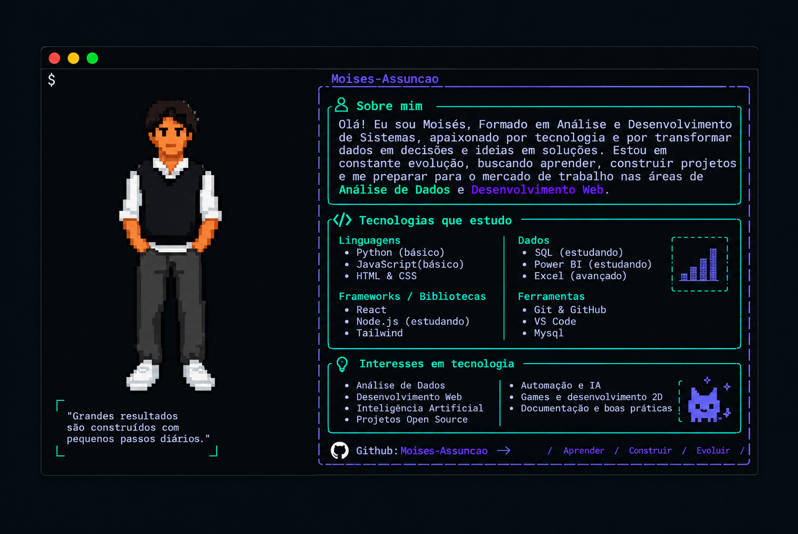

  

  

  

  

  

###

###
<h2 align="left">Rede Sociais</h2>

  
  
  
  
  

###

###

<picture>
  <source media="(prefers-color-scheme: dark)" srcset="https://raw.githubusercontent.com/Moises-Assuncao/Moises-Assuncao/output/pacman-contribution-graph-dark.svg">
  <source media="(prefers-color-scheme: light)" srcset="https://raw.githubusercontent.com/Moises-Assuncao/Moises-Assuncao/output/pacman-contribution-graph.svg">
  
</picture>

